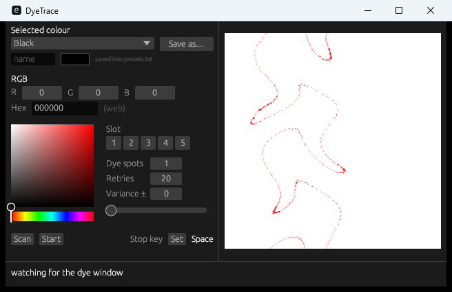

# DyeTrace

**An open-source dye palette finder for Mabinogi** — pick the colour you want, and it finds the spot in the dye gradient that produces it, then clicks it for you.

Windows · C (Win32) · single 32-bit executable · no runtime dependencies



---

## Why this exists

DyeLite is used by a lot of players, but its source code was never published anywhere. DyeTrace is an open-source take on it: the same core workflow — choose a colour, find where it exists in the dye gradient, apply it — rebuilt from scratch and documented, with the minimum capabilities of the original.

It is not a byte-for-byte port. It reproduces the behaviour by reading the screen the same way the original does, and the parts that matter (how the dye window samples the palette, how a match is scored) were measured against the live client and cross-checked against the original binary.

## What it does

- **Finds the dye palette automatically** inside the Mabinogi window.
- **Reads the five sample offsets from the client itself** every attempt, instead of assuming a fixed spacing. The offsets are not universal — they depend on the dye/part set.
- **Matches by count, not by slot order.** You give one colour, a variance, and how many of the five samples must hold it (1–5).
- **Shows a live hit map** - a white pane with red where the colour exists, the same view the original presents, refreshed twice a second while the dye window is open. Boxes and numbers mark the sampled positions once a scan has measured them.
- **Auto mode** runs the whole cycle: `Pick Color` → capture → read offsets → search → click, or `Cancel` and try again. Presses are gated on the button's label, so a dye is never applied by accident.
- **Stops on demand** with a key you choose: press `Set`, press the key, and it is watched wherever the keyboard focus is.
- **Self-tests** (`--selftest`) so you can check a build without opening the game.

## Repository layout

- `crates/core` - platform-free matching: palette detection, legend offsets, the search, and the twelve behaviour checks as tests
- `crates/platform` - the `Screen` / `Mouse` / `GameWindow` traits, plus BMP replay fakes so the pipeline runs without a client
- `crates/platform-win` - the Win32 backend (`BitBlt`, verified pointer moves, window focus)
- `crates/app` - the CLI: `--selftest`, `--replay`, `--probe`, `--snapshot`, `--auto`
- `crates/engine` - the dye cycle itself, shared by the CLI and the window
- `crates/ui` - the windowed interface (egui): colour picker, presets, hit map
- `legacy/c-reference` - the single-file C reference implementation (`dyetrace.c`, `build.bat`) that the Rust port was verified against

## Requirements

- Windows (the binary is x86; it runs fine on 64-bit Windows).
- Mabinogi running in a **window** (not exclusive fullscreen), with the dye window open and the palette visible.
- The client must be the foreground window: DyeTrace reads the palette from the screen.

## Build

The Rust implementation (recommended):

```bat
cargo build --release     :: target\release\dyetrace.exe     (CLI)
                          :: target\release\dyetrace-ui.exe  (window)
cargo test                :: behaviour checks + offset/search/backend tests
```

The C reference, kept for parity work (needs MSVC):

```bat
cd legacy\c-reference
build.bat
```

or directly:

```bat
cl /nologo /O2 /W3 /D_CRT_SECURE_NO_WARNINGS dyetrace.c /Fe:dyetrace.exe ^
   /link /SUBSYSTEM:WINDOWS user32.lib gdi32.lib
```

## Usage

`dyetrace-ui.exe` is the window: the controls and the colour picker on the
left, the search preview on the right, and one line of feedback along the
bottom.

The preview looks after itself: as soon as the dye window is on screen it shows
the hit map for the chosen colour, and it keeps it current. It pauses while a
colour is being picked (the button reads Start Dyeing) and resumes on Cancel,
because a legend drawn over the grid would otherwise end up in the picture. The
sample markers belong to the roll they were measured on: once the palette is
rolled again they disappear until the next Scan.

| Control | Meaning |
|---|---|
| `Selected colour` / `Save as…` | Named colours, stored in `presets.txt` next to the executable. |
| `R` `G` `B`, `Hex` | The dye colour. All three stay in sync with the picker. |
| Colour square + hue strip | Pick the colour visually; the square follows the chosen colour. |
| `Slot` | Optional. Press 1–5 to require those samples to hold the colour; press a number again to clear it. Several can be picked. The numbers are the ones the dye window prints above its five previews: 1 is under the cursor, 2–3 above it, 4–5 below. |
| `Dye spots` | How many of the five samples must hold the colour (1–5). Which samples fill that up is where `Slot` comes in. |
| `Retries` | How many new rolls a run may try, after the first, before giving up. `0` keeps rolling until a match or the stop key. |
| `Variance ±` | Per-channel tolerance as a number, or drag the slider below it. `0` = exact match. |
| `Scan` | Read the client's sample offsets, search, and draw the hit map. Nothing is clicked except Pick Color, and only if the picker is not already armed. |
| `Start` | Run the cycle until it clicks a match or the stop key is pressed. |
| `Stop key` | `Set` waits for a key press and records it; the key shown beside the button is the one that stops a running cycle. Space by default. It is polled globally, so it works while the game has the keyboard focus. |

The preview is the same view the original presents: white with red where the
colour exists, blue squares for the client's legend, numbered points for the five
samples and a green crosshair on the best position.

### Slots and spots together

`Dye spots` says how many of the five samples must hold the colour; the slot
buttons say where those hits may come from.

| Chosen slots | Rule |
|---|---|
| none | any `Dye spots` of the five will do |
| fewer than spots | every chosen slot must hold it, and the rest of the spots can come from any other sample |
| as many as spots | every chosen slot must hold it |
| more than spots | only the chosen slots are asked, and any `Dye spots` of them will do |

For example, slot 2 with 3 spots needs slot 2 plus two of the others; slots
1 3 5 with 3 spots needs all three; slots 1 3 5 with 2 spots needs any two of the
three. A chosen slot the legend did not show is ignored, and a position is only
clicked when the whole rule is satisfied - a near miss is logged with
`- short of it` and the attempt rolls on.

### The dye window's buttons

The bottom row of the dye window has two buttons whose meaning changes as you
use them:

| Button state | What happens |
|---|---|
| **Pick Color** | White label. Puts the window into picking mode and rolls a new gradient. This is the only state in which the tool may press it. |
| **Start Dyeing** | Grey label, shown as soon as a colour has been picked. Pressing it applies the dye and closes the window. |
| **Cancel** | Discards the chosen colour and **brings the Pick Color label back**, leaving the window open - but only while the label reads Start Dyeing. Pressed while the window is idle it closes the dye window instead. |

A click is therefore never sent blind. DyeTrace reads the label out of the same
grab the gradient comes from - the white label has about forty pixels brighter
than luminance 130 and the grey one none - and acts on what it says:

- **Pick Color** - press it once, then capture the new gradient;
- **Start Dyeing** - press nothing, the pick is already armed;
- **unreadable** - press nothing and stop, rather than guess.

Auto raises the client before it looks for anything, and every Cancel is
confirmed by reading the label back.

The legacy GUI (`legacy\c-reference`) has the field table below.

| Field | Meaning |
|---|---|
| `colour #` | The dye colour as hex (`000000`, `C1663A`, …). |
| `variance` | Per-channel tolerance. `0` = exact match. |
| `slots` | How many of the five samples must hold the colour (1–5). Which sample holds it does not matter. |
| `btn x/y` | Offsets of the client's **Pick Color** / **Cancel** buttons from the palette's top-left corner. Only needed if your UI layout differs. |

1. **Pick col** to take the colour under your cursor, or type the hex yourself.
2. **Find field** — locates the palette and reports the gradient it found (`colour field found at (x,y) gradient 80%`).
3. **Scan** — puts the cursor on the grid, reads the sample offsets, and searches. The status line reports the result, e.g. `3 of 5 samples hold #000000 (need 3) - cursor to (148,80) dist=0`.
4. **Auto** — runs the cycle until it finds and clicks a match. Spacebar or **Stop** ends it.

## How it works

1. **Locate the palette.** The dye palette is a 256×256 square, so DyeTrace looks for the square whose four borders are edges and whose interior varies. That works regardless of which colours the palette happens to contain.
2. **Capture once per attempt.** The gradient is grabbed right after `Pick Color` and before the cursor touches it, so the image never contains the client's marker graphics. The cursor waits below the palette in between, where the client's camera cannot take it.
3. **Read the sample offsets.** Hovering the grid makes the client draw five markers. Each marker is a **crosshair** (the sample point) joined by a short neck to a **legend box** that shows the colour found there; the box sits 10 px to the right of its crosshair. Measured on every box: `box_fill == gradient[box_centre + (-10, 0)]`, exactly. The samples are then numbered the way the dye window numbers its five previews — 1 under the cursor, 2 and 3 above it, 4 and 5 below — so a chosen slot means the same thing on both sides.
4. **Watch the palette.** A thread of its own grabs the palette every 500 ms and publishes it, so the picture on screen is always current and the engine's own grabs travel the same path: what is drawn is what was searched. The picture is skipped when it would contain a legend, and the thread stops publishing while a colour is being picked.
5. **Tell one roll from another.** Each published palette carries a coarse signature (the average colour of a 32x32 grid). A scan records the signature it measured, and its offsets are only drawn while the palette still matches — a rolled palette means the offsets are unknown.
4. **Search.** For every position in the 254×254 palette, sample the five offsets (wrapping ±256, rejecting the separator/background at 254–255) and count how many are within the variance. Keep the best count, then the lowest colour distance. The chosen slots narrow where the hits may come from, as described above; a position only counts when every guaranteed slot holds the colour as well as the spot count being met.
5. **Act.** Move the cursor to the match and click — or click `Cancel` and start over.

## Command line

The Rust build (`target\release\dyetrace.exe`):

```bat
dyetrace --selftest                      :: the twelve behaviour checks -> selftest.txt
dyetrace --auto --colour 000000 --slots 3 :: run the dye cycle on the live client
dyetrace --auto --colour 000000 --slot 2  :: same, but require sample 2 to hold it
dyetrace --auto --colour 000000 --slot 1,3,5 :: require samples 1, 3 and 5
dyetrace --auto --dry-run                 :: same, but never click the gradient
dyetrace --probe --out DIR                :: locate the palette, write window/palette BMPs
dyetrace --replay <clean.bmp> [<hover.bmp>] :: run the pipeline against saved frames
dyetrace --snapshot <out.bmp>             :: capture the primary screen
```

The C reference (`legacy\c-reference`) keeps its GUI plus `--selftest`, `--probe`
and `--autotest`.  `--autotest` there drives the whole cycle, writes
`autotest.txt`, and re-rolls the dye colours (Pick Color) but never applies
anything, which makes it the safe way to check a C build.

## Troubleshooting

| Symptom | Cause / fix |
|---|---|
| `no gradient - open the dye window and leave it visible` | The palette is not on screen, or the client is behind another window. Open the dye window and keep it visible. |
| `move this window off the palette - it is covering the colours` | DyeTrace is overlapping the gradient; move it aside. |
| Auto keeps cancelling | The `btn x/y` offsets are not hitting Pick Color / Cancel on your layout. Check them with a screenshot. |
| The dye window closed itself | A Cancel click landed while the button still read Pick Color. Current builds read the label first and only press Cancel when it reads Start Dyeing; if you see this, run the same job from the command line, which prints the lines beginning `button reads`. |
| Nothing gets clicked | The client ignores `SetCursorPos` for its hover state; DyeTrace also injects real mouse movement. If the cursor cannot be placed, the status says `auto: cursor did not reach the match - cycle aborted` and the cycle stops rather than clicking blind. |
| Wrong spot gets picked | Loosen or tighten `variance`, or change `slots`. Compare against the red hit map — it shows exactly what the search sees. |

## Limitations

- Windows only, and it reads the screen: the palette must be visible and unobstructed.
- One colour per run. The original supported a different colour per slot; DyeTrace matches a single colour against N of the five samples.
- No profiles or saved colour sets yet — settings live in the window.
- Only tested against the current English client; button offsets are configurable for other layouts.
- The UI is English only.

## Files it writes

| File | Contents |
|---|---|
| `scan.log` | One line per scan: marker positions, offsets used, sampled colours, and the confirmation reading. Useful when reporting a problem. |
| `selftest.txt` | Output of `--selftest`. |
| `probe.txt`, `*.bmp` | Output of `--probe` (palette detection diagnostics). |
| `autotest.txt` | Output of `--autotest`. |

## Credits

- **DyeLite G13** by Merryangel (2009), English fix by Rii — the original tool whose behaviour this reimplements.
- **DyeRite** for insight into how the dye palette is laid out.
